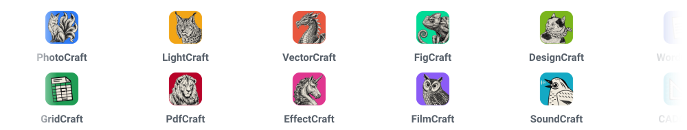
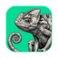
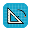
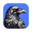

# ArtCraft Agent Skills

**Eighteen evidence-verified agent skills — plain `SKILL.md` files following the [agentskills.io](https://agentskills.io) standard — that teach AI coding agents to drive the [ArtCraft](https://getartcraft.com) creative suite. Built for Claude Code, OpenAI Codex & ChatGPT desktop, OpenCode, Devin, CommandCode, ZCode, Google Antigravity and Gemini CLI.**

<p align="center">
  
</p>

ArtCraft is the open-source, clean-room creative suite from the [`storytold`](https://github.com/storytold) organization — thirteen pure-Rust apps covering image editing, photo raw development, vector illustration, interface design, page layout, word processing, presentations, spreadsheets, PDF work, motion graphics, video editing, audio and 2D CAD, plus ArtCraft Studio, a Rust + TypeScript AI image and video generation workspace, all installable via the [ArtCraft Launcher](https://github.com/storytold/craft-launcher) — and four more the collection covers: Craft Anything (ArtCraft's own "see how software works, rebuild it with AI" workbench), SolidCraft (Tangency Labs' parametric 3D CAD), TextureCraft (3D texture painting) and MaterialCraft (node-based procedural materials and PBR map export).

Each skill teaches an AI coding agent **what one app can really do, what it cannot do yet, and how to drive it correctly** — through the app's first-class automation surface (headless CLI, [MCP](https://modelcontextprotocol.io) (Model Context Protocol) server, localhost JSON control channel, or ArtCraft's Omni HTTP API) rather than blind GUI automation. Mention an app or one of its file formats — `.psd`, `.pptx`, `.xlsx`, `.docx`, `.dxf` — and the matching skill triggers.

**Works with:** any agent that implements the [agentskills.io](https://agentskills.io) `SKILL.md` standard — Claude Code, OpenAI Codex & ChatGPT desktop, OpenCode, Devin, CommandCode, ZCode, Gemini CLI, Google Antigravity and more. One command per agent:

| Agent | Install | Skill directory it scans |
|---|---|---|
| OpenAI Codex · ChatGPT desktop | `bash install.sh` | `~/.agents/skills/` |
| ZCode | `bash install.sh` | `~/.agents/skills/` (also `~/.zcode/skills/`) |
| Devin | `bash install.sh` | `~/.agents/skills/` |
| CommandCode | `bash install.sh` | `~/.agents/skills/` (also `~/.commandcode/skills/`) |
| Claude Code | `bash install.sh --claude` | `~/.claude/skills/` |
| OpenCode | `bash install.sh --opencode` | `~/.config/opencode/skills/` |
| Gemini CLI | `bash install.sh --gemini` | `~/.gemini/skills/` (also `~/.agents/skills/`) |
| Google Antigravity | `bash install.sh --antigravity` | `~/.gemini/config/skills/` |
| claude.ai · Claude Desktop | zip upload (Settings → Capabilities → Skills) | per-chat upload |
| Windows (any of the above) | `.\install.ps1` (`-Claude`, `-OpenCode`, `-Gemini`, `-Antigravity`) | `%USERPROFILE%\` equivalents |

The SKILL.md files are plain Markdown + shell, so any agent that can read files can use them. Full per-agent options are under [Install](#install) below.

## Install

Clone once, then pick the target that matches your agent:

```sh
git clone https://github.com/midasmatterhorn/artcraft-skills.git
cd artcraft-skills
```

### One paste: let your coding agent do it

Copy this into your agent (Claude Code, Codex, ChatGPT, OpenCode, Devin, CommandCode, ZCode, or any coding agent):

```text
Clone https://github.com/midasmatterhorn/artcraft-skills.git into a temporary directory, then install the skills for the agent I'm using now:
- Windows: run `.\install.ps1`; if you are Claude Code use `.\install.ps1 -Claude`, if you are OpenCode use `.\install.ps1 -OpenCode`, if you are Gemini CLI use `.\install.ps1 -Gemini`, if you are Antigravity use `.\install.ps1 -Antigravity`, and add `-Force` to overwrite existing installs.
- OpenCode (macOS/Linux): run `bash install.sh --opencode`, which installs into ~/.config/opencode/skills/.
- Claude Code (macOS/Linux): run `bash install.sh --claude`, which installs into ~/.claude/skills/.
- Gemini CLI (macOS/Linux): the default install works — Gemini CLI scans ~/.agents/skills/ too; use `bash install.sh --gemini` to scope it to ~/.gemini/skills/ instead.
- Google Antigravity (macOS/Linux): run `bash install.sh --antigravity`, which installs into ~/.gemini/config/skills/, Antigravity's global skills directory.
- Everyone else (OpenAI Codex, ChatGPT desktop, ZCode, Devin, CommandCode, or any other SKILL.md-standard agent): run `bash install.sh`; the default target is ~/.agents/skills/, which those agents scan natively.
Verify the install: all 18 skill directories must be present under the target directory, each containing SKILL.md and agents/openai.yaml. Print the target directory you used.
Then tell me to restart my agent session so the new skills are discovered.
```

Works as-is in Claude Code, Codex, OpenCode, Devin, CommandCode, ZCode, Gemini CLI and Antigravity; any SKILL.md-standard agent can follow it too.

### Standard agents (Codex, ChatGPT, ZCode, Devin, CommandCode)

```sh
bash install.sh            # default target: ~/.agents/skills/
```

`~/.agents/skills/` is the shared directory that OpenAI Codex, ChatGPT desktop, ZCode, Devin, CommandCode and Gemini CLI all scan natively (ZCode also reads `~/.zcode/skills/`; CommandCode also reads `~/.commandcode/skills/`; Gemini CLI treats `~/.agents/skills/` as an alias for `~/.gemini/skills/` and prefers the alias within that tier). Every skill ships an `agents/openai.yaml` sidecar so the Codex/ChatGPT UI shows the proper display name and description. CommandCode users can alternatively install natively with `cmd skills add midasmatterhorn/artcraft-skills --global`.

Invoke a skill explicitly with `$photocraft` (or `$wordcraft`, …), or let implicit triggering fire when you mention an app or an extension like `.psd`, `.pptx`, `.xlsx`, `.docx` or `.dxf`. If a freshly installed skill doesn't show up, restart your agent.

### Claude Code

```sh
bash install.sh --claude   # copies all 18 skills into ~/.claude/skills/
```

`--claude` targets Claude Code's user-scoped `~/.claude/skills/` directory (a project-scoped `.claude/skills/` works the same way). Prefer symlinks when you want `git pull` to keep skills current:

```sh
ln -s "$PWD/photocraft" ~/.claude/skills/photocraft   # repeat for each skill
```

### OpenCode

```sh
bash install.sh --opencode   # copies all 18 skills into ~/.config/opencode/skills/
```

`--opencode` targets OpenCode's global skills directory `~/.config/opencode/skills/`, where they are discovered for every project. To scope skills to a single project instead, symlink them into that project's `.opencode/skills/` directory:

```sh
ln -s "$PWD/photocraft" .opencode/skills/photocraft   # repeat for each skill
```

As with Claude Code, symlinks mean `git pull` keeps the installed skills current.

### Gemini CLI

```sh
bash install.sh --gemini   # copies all 18 skills into ~/.gemini/skills/
```

`--gemini` targets Gemini CLI's user-scoped `~/.gemini/skills/` directory. Gemini CLI also scans the shared `~/.agents/skills/` (preferring it within the same tier), so the default install already works — use `--gemini` only when you want the skills scoped to Gemini alone. For a single project, symlink into that project's `.gemini/skills/` (or its `.agents/skills/` alias):

```sh
ln -s "$PWD/photocraft" .gemini/skills/photocraft   # repeat for each skill
```

### Google Antigravity

```sh
bash install.sh --antigravity   # copies all 18 skills into ~/.gemini/config/skills/
```

`--antigravity` targets Antigravity's global skills directory `~/.gemini/config/skills/`, discovered across the Antigravity app, IDE and CLI. For a single project, symlink into the repo's `.agents/skills/` directory, which Antigravity scans at workspace level:

```sh
ln -s "$PWD/photocraft" .agents/skills/photocraft   # repeat for each skill
```

### claude.ai / Claude Desktop

Zip a skill folder and upload it via **Settings → Capabilities → Skills**:

```sh
cd artcraft-skills && zip -r photocraft.skill.zip photocraft
```

### Windows (PowerShell / WSL)

Native Windows: after cloning, run the PowerShell installer (`install.ps1`):

```powershell
powershell -ExecutionPolicy Bypass -File .\install.ps1   # or .\install.ps1 in an existing PowerShell session
```

`-Claude` targets Claude Code's `%USERPROFILE%\.claude\skills`, `-OpenCode` targets OpenCode's `%USERPROFILE%\.config\opencode\skills`, `-Gemini` targets Gemini CLI's `%USERPROFILE%\.gemini\skills` and `-Antigravity` targets Antigravity's `%USERPROFILE%\.gemini\config\skills`; the default is `%USERPROFILE%\.agents\skills` (scanned natively by Codex, ChatGPT desktop, ZCode, Devin, CommandCode and Gemini CLI on Windows), and `-Force` overwrites existing installs.

On WSL or Git Bash the bash installer works unchanged (`bash install.sh`, `--claude`, `--opencode`, `--gemini`, `--antigravity`) — no need for `install.ps1` there. The skill folders are plain Markdown; only the paths inside the docs are written macOS-first (see the Platforms note below).

### Manual / other agents

Copy or symlink any skill folder into the directory your agent reads — the format is the portable SKILL.md standard, so nothing here is Claude-, Codex- or OpenCode-specific. `install.sh` also accepts `--force` to overwrite existing installs (e.g. `bash install.sh --force`).

Skills trigger automatically when you mention an app or its file formats (`.psd`, `.pptx`, `.xlsx`, `.docx`, `.dxf`, `.deckcraft`, `.scraft`, …), or force one in-session with `/photocraft` (Claude Code) or `$photocraft` (Codex).

> **Platforms:** Installing works the same on macOS, Linux and Windows (targets above), and the SKILL.md format itself is OS-agnostic. The skill *bodies*, however, were authored against macOS app installs: launch and paths sections cite `/Applications/<App>.app` and `~/Library/Application Support/...`. The apps ship native Windows and Linux builds with the same CLI/MCP/command surfaces (binary names gain `.exe` on Windows; config and log paths move under `%APPDATA%`/`%LOCALAPPDATA%` on Windows and `~/.local/state` etc. on Linux) — so treat the macOS paths as the conceptual location and check the app's own docs/output for exact equivalents on your OS.

> **Windows:** an agent that runs in your desktop session can start a GUI app directly (a hidden console does not change the window station). An agent running as a service / session 0 has no desktop to draw on — point it at the headless CLI or MCP surface, or launch the app yourself. The shipped `AGENTS.md` covers the live control channel, including per-app authentication and the last-resort Task Scheduler path.

## The skills

One skill per app across the whole Craft App Suite — the same tools the [ArtCraft Launcher](https://github.com/storytold/craft-launcher) installs:

| App | What it's for | Skill | Skill based on | GitHub |
|---|---|---|---|---|
| &nbsp;**[ArtCraft Studio](https://github.com/storytold/artcraft)** | AI image and video generation workspace | [`artcraft-studio`](artcraft-studio) | 0.41.1&nbsp;@&nbsp;`07ebde1` | [GitHub](https://github.com/storytold/artcraft) |
| &nbsp;**[PhotoCraft](https://getartcraft.com/apps/photocraft)** | Image editing: layers, masks, type and real PSD files | [`photocraft`](photocraft) | 0.21.0&nbsp;@&nbsp;`efb7ebd` | [GitHub](https://github.com/storytold/photocraft) |
| &nbsp;**[LightCraft](https://getartcraft.com/apps/lightcraft)** | Photo library and raw development | [`lightcraft`](lightcraft) | 0.19.0&nbsp;@&nbsp;`16636c4` | [GitHub](https://github.com/storytold/lightcraft) |
| &nbsp;**[VectorCraft](https://getartcraft.com/apps/vectorcraft)** | Vector illustration | [`vectorcraft`](vectorcraft) | 0.22.0&nbsp;@&nbsp;`654749c` | [GitHub](https://github.com/storytold/vectorcraft) |
| &nbsp;**[FigCraft](https://getartcraft.com/apps/figcraft)** | Interface design and prototyping | [`figcraft`](figcraft) | 0.16.0&nbsp;@&nbsp;`f45b261` | [GitHub](https://github.com/storytold/figcraft) |
| &nbsp;**[DesignCraft](https://getartcraft.com/apps/designcraft)** | Page layout and publishing | [`designcraft`](designcraft) | 0.18.0&nbsp;@&nbsp;`58ac6d2` | [GitHub](https://github.com/storytold/designcraft) |
| &nbsp;**[WordCraft](https://getartcraft.com/apps/wordcraft)** | Word processing and documents | [`wordcraft`](wordcraft) | 0.16.0&nbsp;@&nbsp;`02a802c` | [GitHub](https://github.com/storytold/wordcraft) |
| &nbsp;**[DeckCraft](https://getartcraft.com/apps/deckcraft)** | Presentations and slide decks | [`deckcraft`](deckcraft) | 0.16.0&nbsp;@&nbsp;`a3e2254` | [GitHub](https://github.com/storytold/deckcraft) |
| &nbsp;**[GridCraft](https://getartcraft.com/apps/gridcraft)** | Spreadsheets and data | [`gridcraft`](gridcraft) | 0.17.0&nbsp;@&nbsp;`a6a6a49` | [GitHub](https://github.com/storytold/gridcraft) |
| &nbsp;**[PdfCraft](https://getartcraft.com/apps/pdfcraft)** | Reading, organizing and protecting PDFs | [`pdfcraft`](pdfcraft) | 0.19.0&nbsp;@&nbsp;`8c57279` | [GitHub](https://github.com/storytold/pdfcraft) |
| &nbsp;**[EffectCraft](https://getartcraft.com/apps/effectcraft)** | Motion graphics and visual effects | [`effectcraft`](effectcraft) | 0.22.0&nbsp;@&nbsp;`42e3c6a` | [GitHub](https://github.com/storytold/effectcraft) |
| &nbsp;**[FilmCraft](https://getartcraft.com/apps/filmcraft)** | Video editing, color and sound | [`filmcraft`](filmcraft) | 0.18.0&nbsp;@&nbsp;`015d5b3` | [GitHub](https://github.com/storytold/filmcraft) |
| &nbsp;**[SoundCraft](https://getartcraft.com/apps/soundcraft)** | Audio recording and editing | [`soundcraft`](soundcraft) | 0.18.0&nbsp;@&nbsp;`5ff012a` | [GitHub](https://github.com/storytold/soundcraft) |
| &nbsp;**[CADCraft](https://getartcraft.com/apps/cadcraft)** | Computer-aided design | [`cadcraft`](cadcraft) | 0.18.0&nbsp;@&nbsp;`32238e8` | [GitHub](https://github.com/storytold/cadcraft) |
| &nbsp;**[Craft Anything](https://getartcraft.com/apps/craft-anything)** | Study how software works, rebuild it with AI | [`craft-anything`](craft-anything) | 0.5.0&nbsp;@&nbsp;`622d023` | [GitHub](https://github.com/storytold/craft-anything) |
| &nbsp;**[SolidCraft](https://getartcraft.com/apps/solidcraft)** | Parametric 3D CAD | [`solidcraft`](solidcraft) | 0.30.1&nbsp;@&nbsp;`8e2b0cd` | [GitHub](https://github.com/tangency-labs/solidcraft) |
| &nbsp;**[TextureCraft](https://getartcraft.com/apps/texturecraft)** | 3D texture painting | [`texturecraft`](texturecraft) | 0.4.0&nbsp;@&nbsp;`16e9d21` | [GitHub](https://github.com/storytold/texturecraft) |
| &nbsp;**[MaterialCraft](https://getartcraft.com/apps/materialcraft)** | Node-based procedural materials and PBR map export | [`materialcraft`](materialcraft) | 0.2.0&nbsp;@&nbsp;`a1bbd4a` | [GitHub](https://github.com/storytold/materialcraft) |

*Skill based on* names the app release and commit each skill was written and verified against; the apps are early-alpha and move fast, so every skill also carries a *verify against your installed version* note.

Each skill directory contains:

- **`SKILL.md`** — the skill: overview, verified capabilities (tiered implemented / partial / not-implemented, each with a `file:line` evidence pointer into the app repo), known limitations, how to operate (launch, CLI usage, document model, formats), what an AI agent may and may not attempt, an alpha-software verification protocol, and the exact sources inspected.
- **`evidence.md`** — capability → evidence map used to audit the skill.
- **`references/`** (some apps) — deeper tables (commands, formats, shortcuts).
- **`agents/openai.yaml`** — Codex/ChatGPT UI metadata (display name, short description).

## Why these are trustworthy

Every capability claim is traceable to the app's source code. Each skill is written against a pinned release commit and machine-audited: every cited file path is resolved against that tree, every `Sources & evidence` commit must equal the audited tree, and headline counts (engine commands, MCP tools, control methods, formats, effect and preset libraries) are re-derived from code with the method recorded in the skill's `evidence.md`. The November 2026 refresh re-pinned every skill to the 6–7 November app releases, re-measured the automation surfaces, corrected the counts that had drifted, and added the ArtCraft Studio skill; each skill carries a `CHANGES.md` naming exactly what was re-measured and what was carried forward. No capability is documented without a file-level pointer; uncertainty is labeled `uncertain`, never guessed.

The full method, including the regeneration recipe, lives alongside the skill sources (not in this repo).

## Provenance & maintenance

- Apps and their repos move fast (early-alpha, frequent releases; installed bundles often lag repo HEAD). Each skill names the exact commit it describes and carries a *verify against your installed version* note.

## Related

- Apps: https://getartcraft.com/apps · Source: https://github.com/storytold
- Launcher: https://github.com/storytold/craft-launcher
- SolidCraft: https://github.com/tangency-labs/solidcraft (Tangency Labs; skills authored from its public source under the same clean-room documentation rules — MIT OR Apache-2.0)

## License

MIT — see [LICENSE](LICENSE). These skills are original documentation about the ArtCraft apps (MIT OR Apache-2.0); they contain no third-party or proprietary assets and are clean-room-safe. ArtCraft and the app names belong to the ArtCraft/storytold project.
